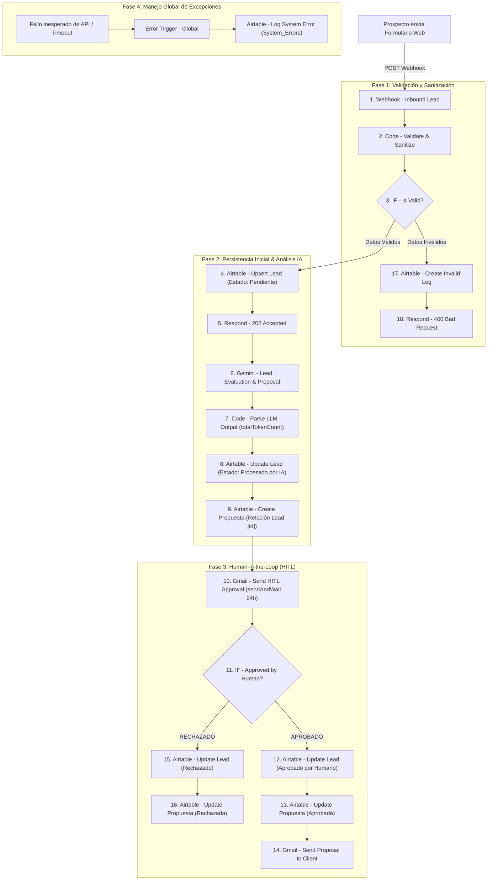

# DealFlow AI — Autonomous B2B Lead Triage, IA Proposal Desk & HITL

<p align="center">
  
  
  
  
  
</p>

---

## 📌 Resumen Ejecutivo del Proyecto

| Parámetro | Detalle de la Solución |
| :--- | :--- |
| **Repositorio GitHub** | [https://github.com/cris2312dev/DealFlow-AI](https://github.com/cris2312dev/DealFlow-AI) |
| **Base de Datos Airtable (Modo Lectura)** | `https://airtable.com/appIW5DwmSvyQB20X` *(Base: DealFlow_AI)* |
| **Orquestador** | **n8n** (Cloud Workflow ID: `8zGSDB0bOT13hTfe`) |
| **Modelo de Inteligencia Artificial** | **Google Gemini 2.5 Flash** (Prompt estructurado con JSON Nativo) |
| **Supervisión Humana (HITL)** | Aprobación interactiva por **Gmail (sendAndWait)** con Timeout de 24h |
| **Canales de Salida** | Gmail API (Propuesta comercial formal al cliente) |
| **Manejo Global de Errores** | `Error Trigger` + Registro automatizado en tabla `System_Errors` |

---

## 💼 Caso de Uso y Justificación de Negocio (B2B SaaS)

En el mercado B2B moderno, **el 60% de los clientes potenciales se pierden por tiempos de respuesta lentos** (más de 24 horas para recibir una primera cotización). Sin embargo, las empresas no pueden automatizar al 100% el envío de propuestas comerciales debido al riesgo de que un modelo de IA prometa alcances inviables o presupuestos equivocados.

**DealFlow AI** resuelve este dilema operativo actuando como un **Deal Desk Autónomo con Supervisión Humana**:
1. Captura prospectos en tiempo real desde la web vía Webhook.
2. Sanitiza y valida la información para evitar inyecciones de prompt y correos no corporativos.
3. Evalúa con **Google Gemini** el nivel de encaje del cliente (Lead Score 0-100), resume la necesidad técnica y calcula una cotización estimada con conteo exacto de tokens.
4. Pausa la ejecución (**Human-in-the-Loop**) y envía una ficha ejecutiva al Director Comercial con botones interactivos (**Aprobar** / **Rechazar**).
5. Tras la aprobación humana, actualiza el CRM en **Airtable** y despacha la propuesta comercial formal al cliente por **Gmail**.
6. En caso de datos inválidos o fallas en APIs externas, aísla el incidente y lo registra en la tabla de auditoría `System_Errors`.

---

## 🔄 Arquitectura del Sistema End-to-End



---

## ⚙️ Cumplimiento de los 4 Componentes Obligatorios

### 1. Orquestador (n8n)
* Flujo modular compuesto por **20 nodos organizados en 6 etapas lógicas**.
* Completamente desacoplado de datos hardcodeados: utiliza referencias dinámicas (`$('Nodo').item.json...`) y credenciales seguras.
* Respuesta asíncrona temprana (`202 Accepted`) para evitar bloqueos del cliente web mientras la IA procesa.

### 2. Base de Datos / Memoria Relacional (Airtable)
* **Base ID:** `appIW5DwmSvyQB20X` (*DealFlow_AI*).
* **Idempotencia:** Operación **Upsert** utilizando `Email` como clave de coincidencia para no duplicar prospectos.
* **Integridad Relacional:** La tabla `Propuestas` vincula al Lead mediante un array relacional `[ record_id ]`.
* **Ciclo de vida por Estados (Single Select):**
  * `Pendiente` → `Procesado por IA` → `Aprobado por Humano` | `Rechazado`

### 3. Procesamiento de IA (Google Gemini 2.5 Flash)
* **Prompt Dinámico y Estructurado:** Genera análisis de dolor, alcance propuesto, monto comercial y Lead Score (0 a 100).
* **Salida Estructurada Nativa:** Configurado con `jsonOutput: true` para garantizar respuestas en JSON estricto sin alucinaciones.
* **Auditoría de Consumo de Tokens:** El nodo de código posterior extrae directamente `usageMetadata.totalTokenCount` y lo persiste en Airtable.

### 4. Human-in-the-Loop (HITL) y Canal de Salida
* **Pausa con Estado:** Implementada mediante el nodo `Gmail (sendAndWait)` con timeout preventivo de 24 horas.
* **Doble Rama Decisional:**
  * **Aprobado:** Actualiza registros a `Aprobado por Humano` y `Aprobada`, y envía la propuesta formal al email del cliente.
  * **Rechazado:** Actualiza registros a `Rechazado` y finaliza el ciclo sin contactar al cliente.

---

## 🗃️ Diccionario de Datos de Airtable

### Tabla 1: `Leads` (Entidad Principal)
| Campo | Tipo Técnico | Rol / Configuración |
| :--- | :--- | :--- |
| `ID_Lead` | Formula | `CONCATENATE("LEAD-", RECORD_ID())` (Clave Primaria) |
| `Email` | Single line text | **Match Key para Upsert** (normalizado en minúsculas) |
| `Nombre_Contacto` | Single line text | Nombre del prospecto |
| `Empresa` | Single line text | Razón social o compañía |
| `Presupuesto_Declarado` | Single select | `< $1.000` \| `$1.000 - $5.000` \| `> $5.000` |
| `Necesidad_Descripcion` | Multiline text | Texto del requerimiento ingresado por el usuario |
| `Lead_Score` | Number (0-100) | Puntuación comercial calculada por Gemini |
| `Estado` | Single select | `Pendiente` \| `Procesado por IA` \| `Aprobado por Humano` \| `Rechazado` |
| `Propuestas` | Linked Record | Relación uno a muchos hacia la tabla `Propuestas` |
| `Origen_Lead` | Single select | Valor por defecto: `Formulario Web` |

### Tabla 2: `Propuestas` (Entidad Relacionada)
| Campo | Tipo Técnico | Rol / Configuración |
| :--- | :--- | :--- |
| `ID_Propuesta` | AutoNumber | Identificador autoincremental |
| `Lead` | Linked Record | Array relacional vinculado a `Leads` |
| `Resumen_Ejecutivo_IA` | Multiline text | Síntesis del dolor detectado por el LLM |
| `Alcance_Sugerido` | Multiline text | Propuesta de implementación técnica |
| `Monto_Estimado` | Currency (USD) | Presupuesto recomendado por la IA |
| `Tokens_Consumidos` | Number | Métrica `totalTokenCount` consumida por Gemini |
| `Estado_Propuesta` | Single select | `En revisión` \| `Aprobada` \| `Rechazada` |

### Tabla 3: `System_Errors` (Auditoría y Resiliencia)
| Campo | Tipo Técnico | Rol / Configuración |
| :--- | :--- | :--- |
| `ID_Error` | AutoNumber | Identificador del fallo |
| `Fecha_Hora` | Created time | Timestamp automático del incidente |
| `Workflow_Name` | Single line text | Nombre del flujo (`DealFlow AI`) |
| `Node_Name` | Single line text | Nombre del nodo que generó la excepción |
| `Error_Message` | Multiline text | Mensaje descriptivo del error |
| `Payload_Input` | Multiline text | Dump del payload que originó la falla |
| `Status` | Single select | `Nuevo` \| `Investigando` \| `Resuelto` |

---

## 🛡️ Gestión de Errores y Resiliencia

1. **Filtro de Entrada (HTTP 400):** Si el payload carece de campos obligatorios o el email no cumple con la expresión regular, se responde inmediatamente `400 Bad Request` y se asienta el motivo en `System_Errors`.
2. **Respuesta Rápida (HTTP 202):** El cliente recibe acuse de recibo antes de la invocación de IA, evitando timeouts de red en el cliente web.
3. **Manejo Global de Excepciones:** El nodo `Error Trigger` intercepta fallas imprevistas de red, caídas de la API de Gemini o límites de tasa de Airtable, volcando la trazabilidad técnica en la base de datos para diagnóstico.

---

## 🧪 Matriz de Pruebas Validadas

| Caso de Prueba | Entrada / Condición | Comportamiento Esperado | Resultado |
| :--- | :--- | :--- | :--- |
| **CP-01: Flujo Completo con Aprobación** | Lead válido con presupuesto `> $5.000` | IA califica, crea propuesta, supervisor hace clic en **Aprobar** | ✅ Lead en `Aprobado por Humano`, propuesta enviada por Gmail |
| **CP-02: Flujo Completo con Rechazo** | Lead válido con bajo encaje técnico | Supervisor hace clic en **Rechazar** en el correo HITL | ✅ Lead en `Rechazado`, no se envía correo al cliente |
| **CP-03: Validación de Payload Inválido** | Email sin arroba o mensaje menor a 15 caracteres | Bloqueo en nodo IF, emisión de `400 Bad Request` | ✅ Log asentado en `System_Errors`, flujo detenido |
| **CP-04: Prevención de Duplicados (Upsert)** | Mismo email enviado por segunda vez | No crea nuevo registro en `Leads`, actualiza el existente | ✅ Idempotencia confirmada por match de email |

---

## 📸 Evidencias de Ejecución

> *Las capturas de pantalla de respaldo se encuentran disponibles en la carpeta `/docs`:*

1. **Lienzo de n8n en Ejecución Exitosa:** `docs/01_n8n_workflow_green.png`
2. **Base de Datos Airtable (Leads Aprobados):** `docs/02_airtable_leads.png`
3. **Base de Datos Airtable (Propuestas Relacionadas):** `docs/03_airtable_propuestas.png`
4. **Correo de Supervisión HITL (Gmail):** `docs/04_gmail_hitl_approval.png`
5. **Correo Recibido por el Cliente:** `docs/05_gmail_cliente_propuesta.png`

---

## 🚀 Instrucciones de Instalación Local

1. Clona este repositorio:
   ```bash
   git clone https://github.com/cris2312dev/DealFlow-AI.git
   ```
2. Abre tu instancia de **n8n** (Cloud o Autoalojado con Docker).
3. Ve a **Workflows** > **Import from File** y selecciona `workflow/dealflow_ai_workflow.json`.
4. Configura las siguientes credenciales en n8n:
   * **Airtable Personal Access Token:** Con permisos `data.records:read`, `data.records:write` y `schema.bases:read` vinculados a la base `appIW5DwmSvyQB20X`.
   * **Google Gemini API / Gateway Credits:** Para el nodo de procesamiento de lenguaje natural.
   * **Gmail OAuth2:** Para el envío de aprobación y despacho al cliente.
5. Activa el workflow y publica el webhook de producción.

---

## 👤 Autor

**Christian Bocangel** ([@cris2312dev](https://github.com/cris2312dev))

**Proyecto desarrollado como Entrega Final de la Diplomatura en AI Automation — Coderhouse.**
