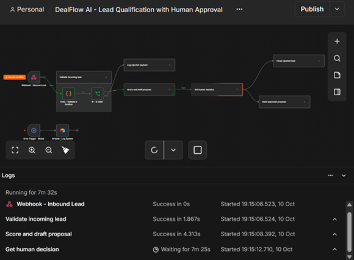
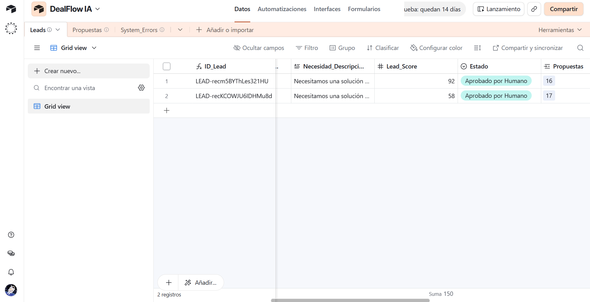
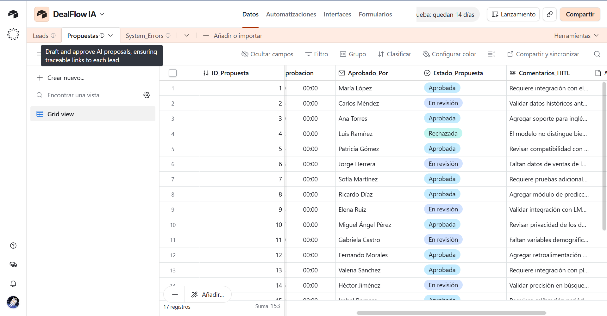
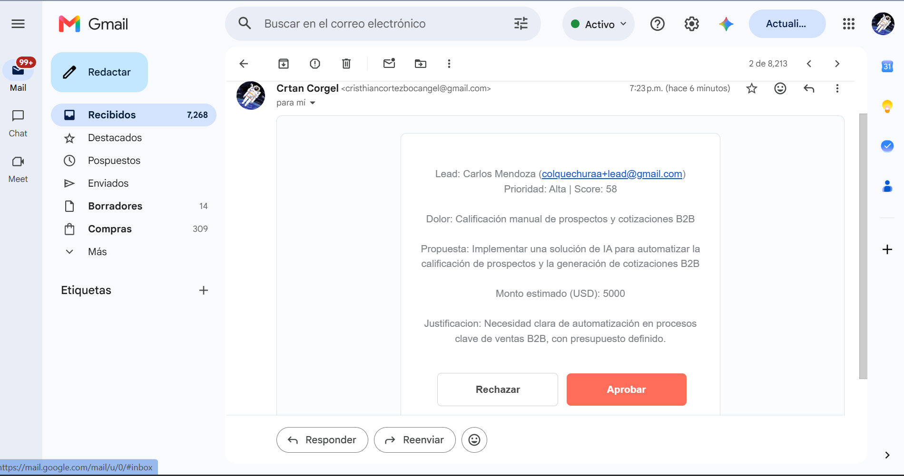
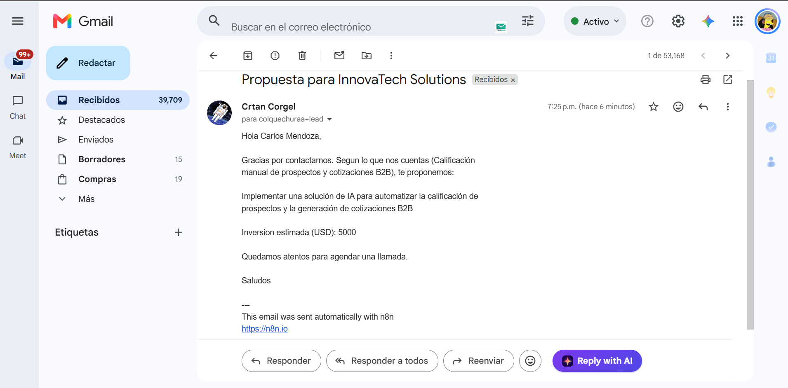

# Guía de Evidencias y Guion de Video Demo (~3 min)

Esta guía te explica qué capturas de pantalla debes guardar en esta carpeta (`/docs`) y el guion paso a paso para grabar el video demo opcional de 3 minutos para asegurar la máxima calificación.

---

## 📸 1. Nombres y Contenido de las Capturas de Pantalla

Guarda tus capturas con estos nombres exactos dentro de la carpeta `docs/`:

| Nombre del archivo | Qué muestra la evidencia | Vista Previa / Estado |
| :--- | :--- | :--- |
| `01_n8n_workflow_green.png` | Flujo en n8n con nodos validados en verde y pausa activa en nodo HITL (`Get human decision`). | Disponible en `/docs` |
| `02_airtable_leads.png` | Tabla `Leads` en Airtable mostrando registros con `Estado: Aprobado por Humano` y `Lead_Score`. | Disponible en `/docs` |
| `03_airtable_propuestas.png` | Tabla `Propuestas` en Airtable con registros vinculados, estados (`Aprobada`, `En revisión`) y comentarios. | Disponible en `/docs` |
| `04_gmail_hitl_approval.png` | Correo de supervisión HITL en Gmail con ficha de Carlos Mendoza y botones interactivos **Rechazar / Aprobar**. | Disponible en `/docs` |
| `05_gmail_cliente_propuesta.png` | Correo formal recibido por el cliente (`colquechuraa+lead`) con la propuesta y cotización de $5.000 USD. | Disponible en `/docs` |
| `06_airtable_system_errors.png` *(Opcional)* | Captura extra opcional de la tabla `System_Errors` ante payloads con error 400. | No obligatoria para entrega |

### 🖼️ Galería Visual de Evidencias

#### 1. Flujo de n8n en Ejecución y Pausa HITL (`01_n8n_workflow_green.png`)

#### 2. Tabla Airtable Leads (`02_airtable_leads.png`)

#### 3. Tabla Airtable Propuestas (`03_airtable_propuestas.png`)

#### 4. Correo de Supervisión HITL en Gmail (`04_gmail_hitl_approval.png`)

#### 5. Correo Recibido por el Cliente (`05_gmail_cliente_propuesta.png`)

---

## 🎙️ 2. Guion para el Video Demo (~3 Minutos)

> **Requisito de seguridad:** Asegúrate de que durante la grabación **no se muestren API Keys, tokens de acceso ni credenciales**.

### Minuto 0:00 - 0:45 | Introducción y Caso de Negocio
* **Qué mostrar en pantalla:** La portada de Airtable y el lienzo general de n8n.
* **Qué decir:**
  > *"Hola, mi nombre es Christian Bocangel y este es DealFlow AI, un sistema de automatización end-to-end diseñado para resolver un problema crítico en ventas B2B: el tiempo de respuesta y la precisión en cotizaciones.*
  > *El sistema captura prospectos, los valida, utiliza Inteligencia Artificial con Google Gemini para calificar el lead y calcular la propuesta, e incorpora supervisión humana (Human-in-the-Loop) antes de que la propuesta formal sea enviada al cliente."*

### Minuto 0:45 - 1:45 | Disparo y Procesamiento con IA
* **Qué mostrar en pantalla:** Herramienta de disparo (Postman / n8n Test Step con el JSON del prospecto Carlos Mendoza).
* **Qué decir:**
  > *"Aquí enviamos un lead interesado con un requerimiento técnico y presupuesto de $5.000 USD.*
  > *n8n recibe la solicitud, valida la estructura del correo mediante Regex y sanitiza el mensaje para evitar inyecciones. Inmediatamente realiza un Upsert en Airtable en estado 'Pendiente' para garantizar idempotencia y devuelve un código 202 al cliente.*
  > *Luego, el nodo de Google Gemini analiza la necesidad, calcula el Lead Score estructurado en JSON nativo, estima el monto y genera la propuesta técnica contabilizando los tokens consumidos."*

### Minuto 1:45 - 2:30 | Human-in-the-Loop (Aprobación)
* **Qué mostrar en pantalla:** Tu bandeja de Gmail abierta con el correo de supervisión (`04_gmail_hitl_approval.png`).
* **Qué decir:**
  > *"En este punto, el flujo entra en pausa controlada. Como Director Comercial, recibo en mi correo una ficha ejecutiva con los datos del prospecto y la propuesta sugerida por la IA.*
  > *Para evitar compromisos comerciales no deseados, la decisión final es humana. Hago clic en el botón 'Aprobar'.*
  > *Automáticamente n8n reanuda la ejecución, actualiza el estado en Airtable a 'Aprobado por Humano' y envía la propuesta formal al correo del cliente."*

### Minuto 2:30 - 3:00 | Verificación en Airtable y Manejo de Errores
* **Qué mostrar en pantalla:** Las tablas de Airtable (`Leads`, `Propuestas` y `System_Errors`).
* **Qué decir:**
  > *"En Airtable vemos cómo el Lead cambió de 'Pendiente' a 'Aprobado por Humano', y en la tabla relacional de Propuestas tenemos el registro vinculado con su resumen técnico y monto de $5.000 USD.*
  > *Por último, el sistema cuenta con un subflujo de resiliencia con el nodo Error Trigger que captura cualquier fallo de red o datos inválidos y los registra en la tabla System_Errors con código 400.*
  > *Con esto completamos una arquitectura robusta, escalable y lista para producción. Muchas gracias."*

